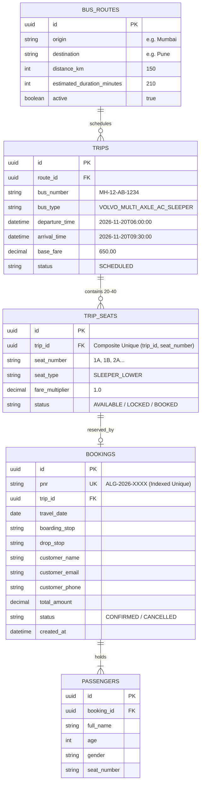

# Bus Booking Platform – Trip & Seat Reservation API
A production-grade, highly secure, observable, and resilient microservice for bus trip management and seat reservations, built for the **ALGIONS AI LABS PRIVATE LIMITED** DevOps & Cloud Engineering Assessment.

This system provides comprehensive capabilities for discovering intercity bus routes, searching scheduled trips, inspecting real-time interactive seat maps, and processing atomic seat reservations. It strictly eliminates double-booking race conditions under high concurrency using PostgreSQL row-level pessimistic locking (`PESSIMISTIC_WRITE`), provides zero-downtime Blue-Green deployment, automated disaster recovery with SHA-256 integrity verification, and is shielded by an Nginx reverse proxy with TLS 1.3 encryption and leaky-bucket rate limiting.

---

## 1. Features
* **Route & Trip Discovery**: APIs to browse active routes and search scheduled trips with origin, destination, and travel date filters.
* **Real-Time Seat Maps**: Dynamic seat availability grid (`AVAILABLE`, `LOCKED`, `BOOKED`) with tier multipliers (Sleeper Lower, Sleeper Upper, Seater).
* **Concurrency-Safe Atomic Bookings**: Prevents double-booking race conditions during simultaneous reservation requests using database-level pessimistic locking (`PESSIMISTIC_WRITE` / `SELECT ... FOR UPDATE`).
* **PNR Generation & Lifecycle**: Secure alphanumeric PNR generation (`ALG-YYYY-XXXX`) and atomic cancellation releasing seats back to `AVAILABLE`.
* **Zero-Downtime Releases**: Blue-Green deployment engine with dynamic Nginx upstream cutover and sub-second instant rollback.
* **Security & Hardening**: Ingress TLS 1.3 reverse proxy, leaky-bucket rate limiting (100 req/min/IP), hardened HTTP security headers, unprivileged non-root container user (`appuser` UID 10001), and dual-network backend isolation (`internal: true`).
* **Production Observability**: Spring Boot Actuator liveness and custom readiness health probes with deep PostgreSQL ping verification and Prometheus metrics scraping.
* **Disaster Recovery**: Automated database backup scripts generating compressed `pg_dump` archives with cryptographic SHA-256 checksums and automated restore validation.

---

## 2. Technology Stack
* **Java 21 LTS** & **Spring Boot 3.3.5** (Web MVC, Data JPA, Validation, Actuator)
* **PostgreSQL 16** (ACID transactional datastore, pessimistic row locking, persistent storage)
* **Redis 7** (In-memory caching layer with TTL eviction and graceful degradation fallback)
* **Nginx 1.25 Alpine** (Ingress reverse proxy, SSL/TLS termination, rate limiting, security headers)
* **Docker & Docker Compose** (Multi-stage build, non-root user, dual bridge networks)
* **Docker Hub Registry**: `shyammedh/bus-booking-platform:1.0.0`
* **GitHub Actions & Jenkins** (Automated compilation, JUnit testing, Trivy container CVE scans)
* **SpringDoc OpenAPI v2.6.0** (Interactive Swagger UI documentation)
* **JUnit 5 & MockMvc** (17 comprehensive unit, integration, and multi-threaded concurrency tests)
* **Terraform (AWS)** (Modularized Infrastructure as Code: Multi-AZ VPC, RDS, ECR, EC2)

---

## 3. Project Structure
The microservice strictly enforces a Clean Layered Architecture with complete separation of concerns:

```text
bus_booking_algion/
├── .github/workflows/ci-cd.yml     # GitHub Actions Pipeline (Test, Trivy Scan, Docker Hub Push)
├── nginx/                          # Reverse Proxy & Ingress TLS
│   ├── nginx.conf                  # Rate-limiting, SSL configuration, security headers
│   ├── upstream.conf               # Dynamic Blue-Green upstream definition
│   └── certs/                      # TLS/SSL certificates and RSA keys
├── prometheus/                     # Prometheus scraping configuration
├── scripts/                        # Production SRE Automation Engine
│   ├── deploy-blue-green.sh        # Zero-downtime Blue-Green deployment cutover
│   ├── rollback.sh                 # Sub-second emergency rollback script
│   ├── backup-db.sh                # Automated gzip backup with SHA-256 checksums
│   ├── restore-db.sh               # Verified disaster recovery restore script
│   └── chaos-drill.sh              # SRE failure injection and recovery drill
├── terraform/                      # Modular AWS Infrastructure as Code
│   ├── main.tf                     # Root Terraform orchestration
│   └── modules/ (vpc, security, rds, ecr, compute)
├── trip_and_reservation_seat/      # Core Spring Boot Domain Service
│   ├── Dockerfile                  # Multi-stage Temurin-21 Alpine Dockerfile (non-root)
│   ├── pom.xml                     # Maven project descriptor
│   └── src/main/java/com/algion/busbooking/
│       ├── config/                 # Swagger OpenAPI & DataSeeder initialization
│       ├── controller/             # REST controllers (Route, Trip, Booking)
│       ├── dto/                    # API Request/Response data transfer contracts
│       ├── entity/                 # Relational domain JPA entities
│       ├── exception/              # Global @RestControllerAdvice exception mapping
│       ├── repository/             # Spring Data JPA repositories with @Lock
│       └── service/                # Business logic & transactional boundaries
├── docker-compose.yml              # Standard production orchestration
├── docker-compose.blue-green.yml   # Blue-Green dual-slot deployment orchestration
├── RUNBOOK.md                      # Operational SRE Incident & Triage Manual
└── README.md                       # Master Architecture & Submission Dossier
```

---

## 4. Database Schema Overview
The relational datastore utilizes a normalized, constraint-enforced PostgreSQL schema:



* **`bus_routes`**: Master catalog of intercity transit corridors.
* **`trips`**: Daily scheduled bus journeys linked to a route, bus number, and timetable.
* **`trip_seats`**: Individual physical inventory items with unique compound constraint `(trip_id, seat_number)`.
* **`bookings`**: Confirmed customer reservations identified by an indexed, unique PNR.
* **`passengers`**: Passenger details linked to a confirmed booking.

---

## 5. PostgreSQL Concurrency Protection (Zero Double Bookings)
To definitively eliminate double-booking race conditions when multiple passengers contest the same seat simultaneously:

1. **Pessimistic Row-Level Locking (`PESSIMISTIC_WRITE` / `SELECT ... FOR UPDATE`)**:
   In `TripSeatRepository`, seat lookup is executed under an exclusive row lock:
   ```java
   @Lock(LockModeType.PESSIMISTIC_WRITE)
   @Query("SELECT s FROM TripSeat s WHERE s.trip.id = :tripId AND s.seatNumber = :seatNumber")
   Optional<TripSeat> findByTripIdAndSeatNumberForUpdate(@Param("tripId") UUID tripId, @Param("seatNumber") String seatNumber);
   ```
2. **Transaction Serialization**:
   * **Thread 1**: Acquires exclusive row lock on the seat. Reads state (`AVAILABLE`), marks status as `BOOKED`, creates booking entity, generates PNR, and commits.
   * **Thread 2 (Simultaneous)**: Blocks at database level waiting for the lock. Upon acquiring the lock, it immediately reads the updated state: `BOOKED`.
   * **Safe Conflict Rejection**: Throws `SeatAlreadyBookedException`, triggering an immediate database rollback and returning HTTP **`409 Conflict`** with message: `"Seat 1A is already booked for this trip"`.
3. **Database-Level Unique Constraints**:
   A composite unique constraint on `(trip_id, seat_number)` guarantees at the relational engine level that two confirmed bookings can never point to the same seat.
4. **Multi-Threaded Test Proof**:
   `BookingConcurrencyTest` executes 10 concurrent threads against the identical seat via `ExecutorService`. Exactly 1 thread succeeds (201 Created) and 9 fail safely (409 Conflict) with zero duplicate PNRs.

---

## 6. Assumptions and Design Trade-offs
* **Scope Discipline (Per Brief § 1 & § 7)**: Omitted consumer passenger web/mobile screens to focus 100% of engineering bandwidth on core API correctness, non-root containerization, network isolation, CI/CD, and disaster recovery.
* **Mocked Payment Verification**: Commercial payment gateway webhooks (e.g. Razorpay/Stripe) are mocked with transactional payment tokens to eliminate third-party credentials and keep the build completely zero-cost and reproducible.
* **UTC Timestamps**: All trip schedules and booking timestamps are persisted as absolute UTC values to prevent regional timezone confusion.
* **Audit-Preserving Cancellations**: Cancelled bookings are updated to `CANCELLED` status and seats are atomically returned to `AVAILABLE`, preserving historical audit records.
* **Dual-Network Isolation**: The application container bridges both `frontend-net` and `backend-net`, while PostgreSQL and Redis reside strictly on `backend-net` (`internal: true`) with **zero host port exposure**.
* **Test Isolation**: Maven automated tests run against an in-memory H2 database for rapid CI builds; full PostgreSQL integration tests run in the Dockerized container pipeline.

---

## 7. API Endpoints

### Health & Observability (Actuator)
| Method | Endpoint | Description | Expected Status |
| :--- | :--- | :--- | :--- |
| `GET` | `/actuator/health/liveness` | Container process liveness probe | `200 OK` (`UP`) |
| `GET` | `/actuator/health/readiness`| Dependency readiness probe (Database connectivity check) | `200 OK` (`UP`) |
| `GET` | `/actuator/prometheus` | Prometheus operational metrics scrape endpoint | `200 OK` |

### Bus Routes & Trips
| Method | Endpoint | Description |
| :--- | :--- | :--- |
| `GET` | `/api/v1/routes` | List all active bus transit routes |
| `GET` | `/api/v1/trips` | Search scheduled trips (filters: `origin`, `destination`, `date`) |
| `GET` | `/api/v1/trips/{tripId}` | Retrieve specific trip details |
| `GET` | `/api/v1/trips/{tripId}/seats` | Real-time seat availability map |

### Bookings & Reservations
| Method | Endpoint | Description |
| :--- | :--- | :--- |
| `POST` | `/api/v1/bookings` | Atomic seat reservation (concurrency safe) |
| `GET` | `/api/v1/bookings/{pnr}` | Retrieve booking & ticket details by PNR |
| `POST` | `/api/v1/bookings/{pnr}/cancel` | Cancel booking and release seat back to inventory |

---

## 8. Environment Variables & Port Map

### Network Port Allocation Map
| Service | Container Name | Host Port | Internal Port | Network Binding | Purpose |
| :--- | :--- | :--- | :--- | :--- | :--- |
| **Edge Proxy** | `algion-nginx-proxy` | `80` (HTTP) | `80` | `frontend-net` | Auto-redirects to HTTPS (301 Permanent) |
| **Secure Ingress** | `algion-nginx-proxy` | `443` (HTTPS) | `443` | `frontend-net` | TLS 1.3 Termination, Rate Limiting (100 req/min) |
| **Spring Boot API**| `algion-bus-booking-api`| *Shielded* | `8080` | `frontend-net`, `backend-net` | Core Domain Service, Actuator, Swagger UI |
| **PostgreSQL 16** | `algion-postgres-db` | *Shielded* | `5432` | `backend-net` (`internal: true`) | Primary ACID Store, Row-Level Locking |
| **Redis 7** | `algion-redis-cache` | *Shielded* | `6379` | `backend-net` (`internal: true`) | High-speed cache for routes and seat availability |

### Environment Configuration (`.env`)
| Variable Name | Default / Example Value | Description |
| :--- | :--- | :--- |
| `SPRING_PROFILES_ACTIVE` | `docker` | Activates Docker profile configurations |
| `SPRING_DATASOURCE_URL` | `jdbc:postgresql://postgres:5432/bus_booking_db` | JDBC connection string inside `backend-net` |
| `SPRING_DATASOURCE_USERNAME`| `postgres` | Database superuser account |
| `SPRING_DATASOURCE_PASSWORD`| *(Strong secret from .env)* | Database password (never committed to Git) |
| `SPRING_DATA_REDIS_HOST` | `redis` | In-memory cache hostname |
| `SPRING_DATA_REDIS_PORT` | `6379` | Redis port on isolated backend network |
| `APP_PORT` | `8080` | Application container port |
| `RATE_LIMIT_PER_MINUTE` | `100` | Nginx leaky-bucket rate limiting threshold per client IP |
| `DOCKERHUB_USERNAME` | `shyammedh` | Docker Hub username for container registry |
| `DOCKERHUB_TOKEN` | *(Personal Access Token)* | Personal access token for Docker Hub push/pull |

---

## 9. Local Setup Instructions

### Option A: 1-Command Startup (Recommended)
Ensure Docker & Docker Compose are running:
```bash
# 1. Clone repository
git clone https://github.com/shyam-medh/ALGION-DevOps-Intern-Bus-Booking-Platform-.git
cd ALGION-DevOps-Intern-Bus-Booking-Platform-

# 2. Copy environment template
cp .env.example .env

# 3. Launch complete containerized platform
docker compose up -d --build
```

### Option B: Pull Pre-built Image from Docker Hub
```bash
docker pull shyammedh/bus-booking-platform:1.0.0
docker compose up -d
```

### Verify Running Services
```bash
docker compose ps
```
*All 4 containers (`algion-nginx-proxy`, `algion-bus-booking-api`, `algion-postgres-db`, `algion-redis-cache`) will report `healthy`.*

---

## 10. Testing
The repository contains a comprehensive automated test suite covering JPA mappings, REST contract MockMvc tests, Actuator health indicator assertions, and multi-threaded race condition validations:

```bash
cd trip_and_reservation_seat
mvn clean test
```

### Test Results
```text
[INFO] Running com.algion.busbooking.ActuatorHealthTest
[INFO] Tests run: 2, Failures: 0, Errors: 0, Skipped: 0
[INFO] Running com.algion.busbooking.BookingConcurrencyTest
[INFO] Tests run: 1, Failures: 0, Errors: 0, Skipped: 0
[INFO] Running com.algion.busbooking.BookingControllerTest
[INFO] Tests run: 4, Failures: 0, Errors: 0, Skipped: 0
[INFO] Running com.algion.busbooking.RepositoryMappingTest
[INFO] Tests run: 4, Failures: 0, Errors: 0, Skipped: 0
[INFO] Running com.algion.busbooking.RouteControllerTest
[INFO] Tests run: 2, Failures: 0, Errors: 0, Skipped: 0
[INFO] Running com.algion.busbooking.TripControllerTest
[INFO] Tests run: 4, Failures: 0, Errors: 0, Skipped: 0
[INFO] ------------------------------------------------------------------------
[INFO] BUILD SUCCESS
[INFO] Total tests run: 17, Failures: 0, Errors: 0, Skipped: 0
[INFO] ------------------------------------------------------------------------
```

---

## 11. API Documentation (Swagger UI)
Once launched, the interactive Swagger UI and raw OpenAPI 3.0 specifications are served directly over HTTPS:
* **Interactive Swagger UI**: `https://localhost/swagger-ui/index.html`
* **Raw OpenAPI JSON Spec**: `https://localhost/v3/api-docs`

---

## 12. Submission / Demo Verification Guide
Reviewers can verify all 5 acceptance criteria in under 5 minutes:

1. **Service Health Probes**:
   ```bash
   curl -k https://localhost/actuator/health/readiness
   # Expected: {"status":"UP","components":{"db":{"status":"UP"}}}
   ```
2. **Route & Trip Browsing**:
   ```bash
   curl -k https://localhost/api/v1/routes
   curl -k "https://localhost/api/v1/trips?origin=Mumbai&destination=Pune"
   ```
3. **Atomic Concurrency Test (Pessimistic Locking)**:
   - Book seat `1A`: Returns `201 Created` with unique PNR.
   - Attempt to book seat `1A` again: Immediately returns **`409 Conflict`** (`"Seat 1A is already booked"`).
4. **Failure Detection & Auto-Recovery**:
   - Stop database: `docker stop algion-postgres-db`
   - Readiness immediately signals failure: `curl -k -i https://localhost/actuator/health/readiness` &rarr; **`503 Service Unavailable`**.
   - Restart database: `docker start algion-postgres-db` &rarr; Recovers to **`200 OK`** without application restart.
5. **Disaster Recovery Backup**:
   - Run `bash scripts/backup-db.sh` &rarr; Generates gzip archive with SHA-256 integrity hash in `backups/`.

---

## 13. Example API Flow (End-to-End)

### 1. Discover Routes
```bash
curl -k https://localhost/api/v1/routes
```

### 2. Search Available Trips
```bash
curl -k "https://localhost/api/v1/trips?origin=Mumbai&destination=Pune"
```

### 3. Check Real-Time Seat Map
```bash
# Substitute TRIP_ID from step 2
curl -k https://localhost/api/v1/trips/{TRIP_ID}/seats
```

### 4. Book a Seat (Atomic Reservation)
```bash
curl -k -X POST https://localhost/api/v1/bookings \
  -H "Content-Type: application/json" \
  -d '{
    "tripId": "b1a7d6e2-9c3f-4e1a-8f5b-123456789abc",
    "travelDate": "2026-11-20",
    "boardingStop": "Dadar, Mumbai",
    "dropStop": "Swargate, Pune",
    "customerName": "Rahul Sharma",
    "customerEmail": "rahul@example.com",
    "customerPhone": "+919876543210",
    "passengers": [
      {
        "fullName": "Rahul Sharma",
        "age": 28,
        "gender": "MALE",
        "seatNumber": "1A"
      }
    ]
  }'
```
*Returns `201 Created` with secure PNR `ALG-2026-XXXX`.*

### 5. Lookup Booking by PNR
```bash
curl -k https://localhost/api/v1/bookings/ALG-2026-XXXX
```

### 6. Cancel Booking and Release Seat
```bash
curl -k -X POST https://localhost/api/v1/bookings/ALG-2026-XXXX/cancel
```

---

## 14. Production DevOps & Cloud Infrastructure

### Zero-Downtime Blue-Green Deployment
The system utilizes dual container slots (`app-blue` on port 8081 and `app-green` on port 8082).
```bash
bash scripts/deploy-blue-green.sh
```
1. Spawns the target idle slot with the new image.
2. Polls `/actuator/health/readiness` until returning `UP`.
3. Switches Nginx upstream dynamically and executes `nginx -s reload` (hot reload, zero packet loss).
4. Gracefully terminates the old container.
5. In case of issues, `bash scripts/rollback.sh` triggers a sub-second instant revert.

### CI/CD Pipeline (`.github/workflows/ci-cd.yml` & `Jenkinsfile`)
* **Linting & Code Quality**: Validates Maven POM and executes compiler checks.
* **Unit & Concurrency Tests**: Executes all 17 tests with fail-fast policy.
* **Container Security Vulnerability Scanning**: Aqua Security Trivy scans container images for CRITICAL/HIGH CVEs before release.
* **Registry Publishing**: Automatically tags and pushes images to Docker Hub (`shyammedh/bus-booking-platform:1.0.0` and `latest`) and Amazon ECR.

### Infrastructure as Code (Terraform)
Located in `terraform/`:
* Multi-AZ AWS VPC with public/private subnet topology and Internet Gateway.
* Least-privilege Security Groups isolating Application Load Balancers, ECS/EC2 compute, and RDS.
* Multi-AZ PostgreSQL RDS module with automated daily backups and storage encryption.
* Amazon ECR repository with scan-on-push enabled.
