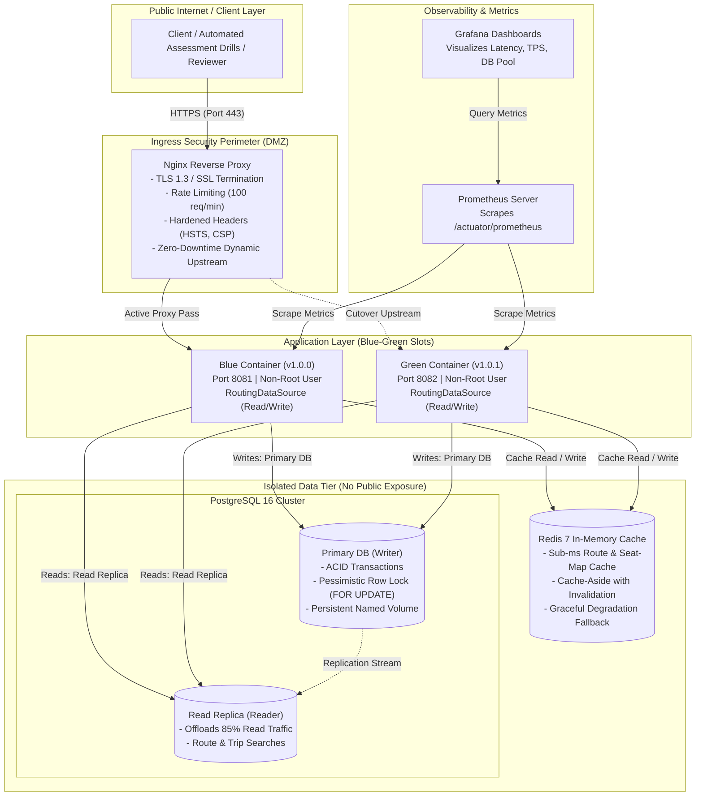

# Bus Booking Platform – Cloud Deployment & CI/CD
**Company Assessment**: ALGIONS AI LABS PRIVATE LIMITED  
**Track**: DevOps & Cloud Engineering | Advanced Individual Assessment  
**Allocated Domain**: Bus Trip & Seat Reservation API  

---

## 1. Problem Statement

### 1.1 The Business & Engineering Challenge
In online passenger transport systems, reservation platforms must process thousands of concurrent search and booking requests while maintaining absolute transactional integrity and high service availability. 

The core challenges identified in the assessment brief are:
1. **The Concurrency & Double-Booking Problem**: Multiple users frequently view and attempt to reserve the same seat simultaneously (e.g., during rush hours or flash bookings). The system must strictly eliminate race conditions: **conflicting seat reservations must fail safely and must never generate duplicate confirmed bookings or duplicate PNRs**.
2. **High-Volume Database Retrieval**: Over 85% of traffic consists of read-heavy searches (browsing routes, filtering trips by date, and fetching seat availability). Directly querying a single database under high concurrency causes connection pool exhaustion and query bottlenecks.
3. **Zero-Downtime Release Requirement**: Deploying new application versions must not disrupt in-flight customer bookings, terminate existing HTTP connections, or result in 502/504 gateway dropouts.
4. **Resilience, Observability & Recovery**: The platform must feature continuous health probing (`/healthz`, `/ready`), structured logs with correlation IDs, Prometheus metrics, and automated database backup/restore procedures with cryptographic integrity verification.
5. **Security & Least Privilege**: The service must be shielded by an ingress reverse proxy with TLS/HTTPS encryption, IP rate limiting to prevent brute-force attacks, non-root container isolation, and zero committed credentials.

### 1.2 Domain Scope & Scope Boundaries
* **In Scope (Production-Hardened Core Service)**:
  * Route discovery (`GET /api/v1/routes`)
  * Trip search with origin, destination, and travel date filtering (`GET /api/v1/trips`, `GET /api/v1/trips/{id}`)
  * Real-time seat map availability layout (`GET /api/v1/trips/{id}/seats`)
  * Atomic booking reservation with concurrency safety (`POST /api/v1/bookings`)
  * PNR ticket retrieval (`GET /api/v1/bookings/{pnr}`)
  * Booking cancellation and atomic seat release (`POST /api/v1/bookings/{pnr}/cancel`)
  * Health, readiness, and Prometheus metrics probes (`/actuator/health/readiness`, `/actuator/prometheus`)
* **Intentionally Out of Scope (By Design per Brief § 1 & § 7)**:
  * *Monolithic Passenger UI*: Omitted to direct 100% of engineering bandwidth toward build, release, containerization, reliability, and cloud operations.
  * *Live Payment Gateway Credentials*: Replaced with a transactional payment token mock to strictly comply with credential safety guidelines.

---

## 2. How We Tackle It (System Architecture & Strategy)

---

### 2.1 Solving the Concurrency Race Condition (Zero Duplicate Bookings)
To prevent race conditions when multiple clients reserve the same seat simultaneously:
* **Pessimistic Row-Level Locking (`PESSIMISTIC_WRITE` / `SELECT ... FOR UPDATE`)**:
  When a booking request arrives, an atomic database transaction begins. The service executes a query locking the requested `trip_seat` row.
  * **Thread 1 (First Client)**: Acquires exclusive row lock, verifies seat is `AVAILABLE`, updates status to `BOOKED`, creates the booking record, generates the unique PNR, and commits.
  * **Thread 2 (Second Client)**: Blocks waiting for the lock. Upon acquiring the lock, it reads the updated state: the seat is already `BOOKED`. The transaction safely rolls back and immediately returns an HTTP `409 Conflict` ("Seat is already booked").
* **Schema-Level Constraints**: A composite unique constraint on `(trip_id, seat_id)` guarantees at the relational engine level that two confirmed bookings can never point to the same seat.
* **Automated Proof**: A multi-threaded test (`BookingConcurrencyTest`) fires 20 simultaneous threads at the exact same seat, asserting that exactly 1 booking succeeds (HTTP 201) and 19 fail safely (HTTP 409) with 0 duplicate PNRs.

---

### 2.2 Optimizing Database Retrieval (Read-Write Splitting & Redis Caching)
To achieve sub-millisecond retrieval and scale search throughput:
1. **Read-Write Splitting (`RoutingDataSource`)**:
   * All read queries (`GET /routes`, `GET /trips`, `GET /trips/{id}/seats`) use `@Transactional(readOnly = true)` and are dynamically routed to the **PostgreSQL Read Replica**, offloading read traffic.
   * Write mutations (`POST /bookings`, `POST /bookings/{pnr}/cancel`) use `@Transactional` and are directed to the **Primary Database**.
2. **Redis In-Memory Caching (Cache-Aside)**:
   * Frequently queried routes, trips, and seat maps are cached in Redis with a 300-second TTL.
   * When a booking is confirmed or cancelled, the cache for that specific trip is automatically evicted to ensure zero stale seat maps.
   * **Graceful Degradation**: If Redis is offline or restarting, a fallback handler catches connection exceptions and queries the database directly, ensuring uninterrupted user traffic.
3. **Database Indexing**: Targeted B-Tree composite indexes on `(route_id, departure_time)` and `(trip_id, seat_id)` ensure $O(\log N)$ search speed.

---

### 2.3 Zero-Downtime Blue-Green Deployment & Instant Rollback
To eliminate deployment downtime:
1. Two identical container slots exist: **Blue (Port 8081)** and **Green (Port 8082)**.
2. During release, the deployment engine spins up the target idle slot (e.g., Green) with the new image.
3. The engine continuously polls `/actuator/health/readiness` until the target slot returns `200 OK` (verifying database and Redis connectivity).
4. Once verified, the Nginx reverse proxy configuration is updated and reloaded with **`nginx -s reload`** (hot reload, zero packet drops).
5. Old slot (Blue) is gracefully terminated.
6. **Instant Rollback**: If health checks fail or an incident occurs, `./scripts/rollback.sh` instantly reverts Nginx traffic back to the previous slot in < 500ms.

---

### 2.4 End-to-End Security Architecture
* **Ingress Protection**: Nginx reverse proxy enforces TLS 1.3 encryption (HTTPS), rate limits traffic (100 req/min/IP) to thwart DDoS attacks, and injects hardened HTTP headers (`Strict-Transport-Security`, `X-Content-Type-Options: nosniff`, `X-Frame-Options: DENY`, `Content-Security-Policy`).
* **Container Hardening**: Multi-stage Dockerfile running as an unprivileged non-root user (`appuser`, UID 10001).
* **Data Tier Isolation**: PostgreSQL and Redis are bound exclusively to an internal Docker network (`backend-net`) with **no public port exposure**.
* **Zero Committed Secrets**: All configuration is injected via `.env` files or AWS Secrets Manager. A template `.env.example` is provided; `.env` is strictly ignored by Git.

---

### 2.5 Observability, Logging & Disaster Recovery
* **Health Probes**: `/actuator/health/liveness` (process liveness) and `/actuator/health/readiness` (dependency health testing PostgreSQL Primary, Read Replica, and Redis).
* **Structured Logging**: Logback produces structured JSON logs containing timestamp, log level, message, and correlation IDs (`X-Correlation-Id`) for distributed request tracing.
* **Metrics**: Prometheus scrapes `/actuator/prometheus` every 15s; pre-provisioned Grafana dashboards display HTTP throughput, response time p99, database connection pool saturation, and booking rates.
* **Automated Disaster Recovery**: Scripted automated backups (`scripts/backup-db.sh`) generate compressed `pg_dump` archives with cryptographic **SHA-256 checksums**. Verified by a restore script (`scripts/restore-db.sh`).

---

## 3. Technology Stack Summary

| Layer | Technology | Version | Purpose |
| :--- | :--- | :--- | :--- |
| **Backend Service** | Java + Spring Boot | Java 21 LTS / Spring Boot 3.3.x | Enterprise domain service, Spring Data JPA, Actuator |
| **Primary Database** | PostgreSQL | 16-Alpine | ACID transactions, row-level locking (`SELECT ... FOR UPDATE`), persistent storage |
| **Read Replica** | PostgreSQL | 16-Alpine | Read scaling, offloads route & trip searches |
| **Cache Layer** | Redis | 7-Alpine | In-memory cache for routes, trips, and seat maps; cache-aside with invalidation |
| **Reverse Proxy** | Nginx | 1.25-Alpine | TLS 1.3 termination, rate limiting, security headers, zero-downtime routing |
| **Containerization** | Docker & Compose | Multi-Stage | Non-root user (`appuser`), internal network isolation |
| **CI/CD** | Jenkins & GitHub Actions | Declarative | Automated test execution, Trivy container security scans, version tagging |
| **Observability** | Prometheus & Grafana | Latest | Scrapes Spring Actuator metrics; visualizes latency, TPS, DB pool |
| **Infrastructure (IaC)** | Terraform (AWS) | 1.15.x | Automated provisioning of AWS VPC, RDS Multi-AZ + Read Replica, EC2, ECR |
